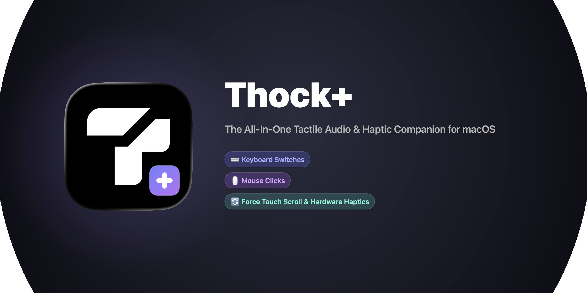

<div align="center">
  
  <br/><br/>
  
  <p align="center">
    <strong>The all-in-one mechanical sound &amp; hardware haptic companion for macOS.</strong><br/>
    Brings the satisfying auditory and tactile feedback of mechanical keyboards, mouse clicks, and scroll wheel detents to your Mac.
  </p>

  <p align="center">
    <a href="https://www.apple.com/macos/"></a>
    <a href="https://swift.org"></a>
    <a href="LICENSE"></a>
    <a href="#install"></a>
  </p>
</div>

---

## ⚡ What is Thock+?

**Thock+** combines the best of mechanical keyboard audio utilities (like `thock`) and mechanical scroll detent utilities (like `snick`) into a single, unified, ultra-fast macOS menu bar application.

Instead of running separate tools or paying for commercial closed-source apps, **Thock+** delivers:
1. **Mechanical Keyboard Audio**: High-fidelity mechanical switch audio on key down and key release.
2. **Mouse Click Audio**: Tactile micro-switch clicks on mouse button press and release.
3. **Scroll Wheel Detents & Hardware Haptics**: Deep mechanical clicks across 7 distinct voices plus **true hardware Force Touch trackpad solenoid oscillation** on every scroll notch.

---

## 🚀 Comparison

| Feature | Original Thock | Snick ($12) | **Thock+ (Open Source)** |
| :--- | :---: | :---: | :---: |
| **Mechanical Keyboard Sounds** | ✅ | ❌ | ✅ (Key-down & Key-up) |
| **Mouse Click Sounds** | ✅ | ❌ | ✅ (Left, Right, Middle) |
| **Scroll Detent Clicks** | ❌ | ✅ | ✅ (All 7 Hand-Tuned Voices) |
| **Real Trackpad Hardware Haptics** | ❌ | ⚠️ Occasional | ✅ **Accurate Hardware `MTActuator`** |
| **Wheel Ratchet Oscillations** | ❌ | ❌ | ✅ **Yes (Solenoid Oscillation)** |
| **Velocity-Aware Volume Scaling** | ❌ | ✅ | ✅ |
| **100% Free & Open Source** | ✅ | ❌ Commercial | ✅ **MIT License** |
| **Offline & Zero Telemetry** | ✅ | ❌ License check | ✅ **100% Offline** |

---

## ✨ Features Breakdown

### 🔄 1. Scroll Detents & Accurate Hardware Haptics
Directly inspired by [trysnick.xyz](https://trysnick.xyz/), with all 7 original mechanical detent voices extracted directly from the web client:
- 🟣 **Nok** (`#6366f1`): Crisp mechanical detent (Default)
- 🟣 **Vyl** (`#a855f7`): Vinyl tick
- 🟢 **Glu** (`#14b8a6`): Gluey pop
- 🟠 **Dib** (`#f97316`): Tight blip
- 🔵 **Plo** (`#3b82f6`): Low plop
- 🩵 **Tok** (`#2dd4bf`): Wooden tok
- 🔴 **Rub** (`#ef4444`): Rubber snap

#### 🛠️ Direct `MTActuator` Hardware Solenoid Control
Unlike standard apps that use Apple's high-level `NSHapticFeedbackManager` (which macOS WindowServer throttles or drops in background apps), **Thock+** communicates directly with the MacBook and Magic Trackpad Taptic Engine via IOKit `AppleMultitouchDevice` and `MTActuatorActuate`:
- **Wheel Ratchet Mode**: Produces an oscillating micro-vibration on every single scroll notch, making your smooth glass trackpad physically feel like a heavy notched scroll wheel!
- **Zero Missed Detents**: Full sub-pixel accumulation math ensures every single notch registers with crisp tactile confirmation.
- **5 Selectable Haptic Feels**:
  - 🌀 **Wheel Ratchet** (Oscillating detent)
  - ⚡ **Crisp Detent** (Mechanical notch)
  - 🪶 **Light Tick** (Subtle tick)
  - 🔘 **Medium Click** (Standard detent)
  - 💥 **Firm Thock** (Heavy tactile bump)

### ⌨️ 2. Mechanical Keyboard Switches
- Crisp mechanical typing feedback on key press and key release.
- Specialized audio samples for `Space`, `Enter`, and `Backspace`.
- Built-in Alps SKCM Blue & Cherry switch profiles.
- Independent volume control and switch release toggle.

### 🖱️ 3. Mechanical Mouse Clicks
- Micro-switch audio on left, right, and middle mouse clicks.
- Built-in Razer Orochi V2 profile.
- Separate press and release audio.

---

## 📦 Quick Start & Installation

### Option 1: 1-Click Install into Applications
```bash
./install.sh
```
This compiles the release binary, creates `Thock+.app`, codesigns it ad-hoc, and installs it into `/Applications`.

### Option 2: Build Locally
```bash
./build.sh
open "Thock+.app"
```

### Option 3: Swift Package Manager
```bash
swift run ThockPlus
```

---

## ⚙️ Granting Accessibility Permission

macOS restricts global event detection across applications for security:
1. Launch `Thock+.app`.
2. Click the **T+** icon in your menu bar.
3. Click **"Grant Permission"** to open **System Settings → Privacy & Security → Accessibility**.
4. Toggle **Thock+** to **ON**.
5. The status badge will immediately illuminate green (**Active**).

> 💡 **Pro-Tip**: **Option-Click** the **T+** menu bar icon anytime to instantly toggle all audio and haptics On/Off!

---

## 🌐 Web Companion Simulator

Test the keyboard, mouse, and scroll detent audio right in your web browser:
```bash
cd Web
python3 -m http.server 8000
```
Open `http://localhost:8000` in Safari, Chrome, or Firefox.

---

## 📁 Repository Structure

```
.
├── Package.swift               # Swift Package Manager manifest
├── build.sh                    # Compiles release binary and creates Thock+.app
├── install.sh                  # Builds and installs to /Applications
├── README.md                   # Documentation
├── LICENSE                     # MIT License
├── docs/
│   ├── logo.png                # Thock+ logo with T+ badge
│   └── banner.png              # GitHub social preview banner
├── Sources/
│   └── ThockPlus/
│       ├── App/                # App delegate, entry point, status item controller
│       ├── Core/
│       │   ├── HardwareHapticEngine.swift   # IOKit & MTActuator hardware solenoid driver
│       │   ├── InputMonitor.swift           # Unified scroll, keyboard & mouse event listener
│       │   ├── KeyboardMouseEngine.swift    # Mechanical keyboard & mouse audio engine
│       │   ├── ScrollProcessor.swift        # Detent accumulation & velocity scaling math
│       │   ├── SoundEngine.swift            # 7-voice scroll detent audio engine
│       │   └── SoundCatalog.swift           # Voice definitions & color palette
│       ├── Models/             # Settings & sound voice models
│       └── UI/                 # SwiftUI popover, voice picker, interactive test area
├── Resources/
│   ├── AppIcon.icns            # Generated macOS application icon with T+ badge
│   ├── MenuBarIcon*.png        # Adaptive T+ template icon for menu bar
│   ├── Info.plist              # macOS bundle configuration
│   └── Sounds/
│       ├── Keyboard/           # Alps SKCM Blue switch audio files
│       ├── Mouse/              # Razer Orochi V2 click audio files
│       └── *.wav               # 7 mechanical scroll detent audio files
└── Web/                        # Interactive web companion demo
    ├── index.html
    ├── style.css
    ├── app.js
    └── sounds/
```

---

## 📄 License

Thock+ is open-source software licensed under the **[MIT License](LICENSE)**.

### Acknowledgments
- Inspired by [kamillobinski/thock](https://github.com/kamillobinski/thock) for mechanical typing audio.
- Sound voice design and audio samples extracted from [trysnick.xyz](https://trysnick.xyz/).
- Multitouch actuator insights from [niw/HapticKey](https://github.com/niw/HapticKey).
